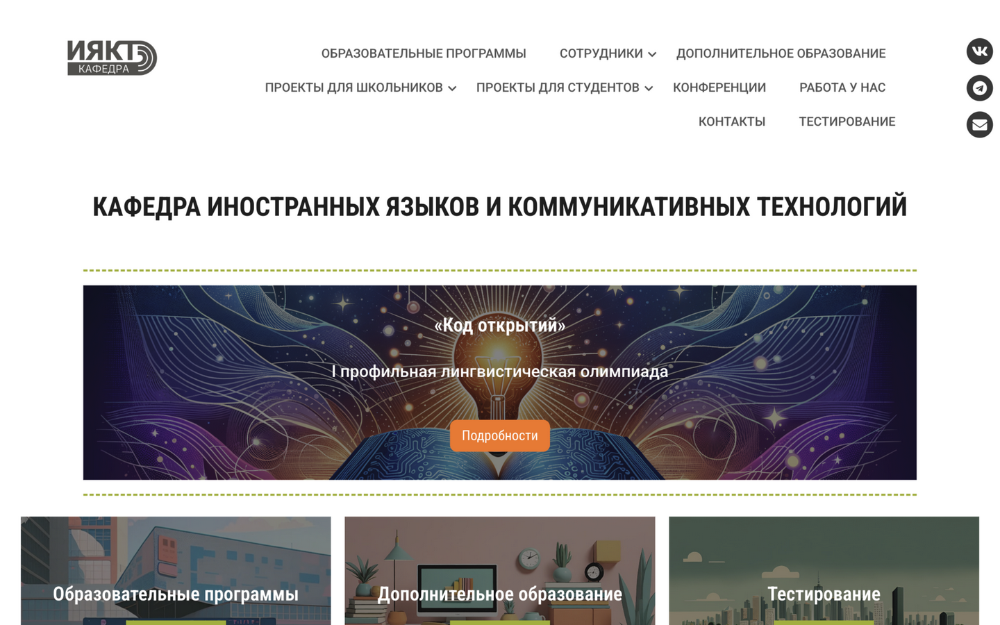
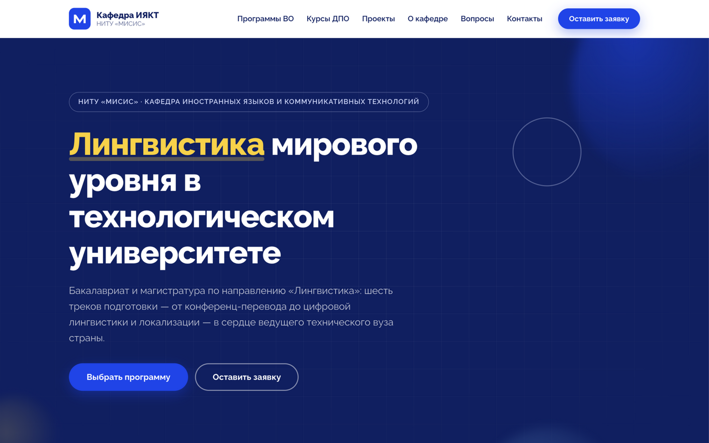
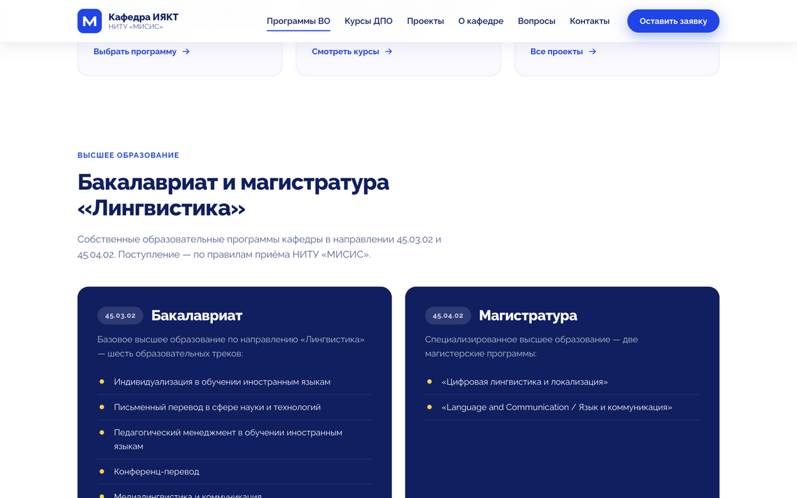
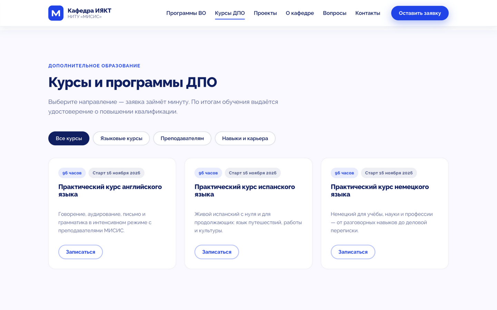
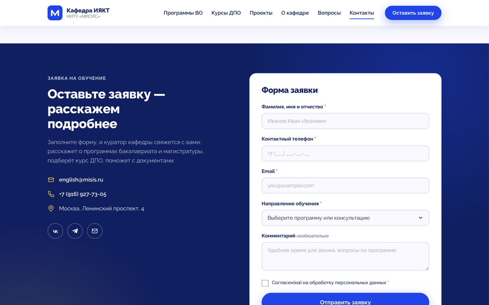

# 🎓 Лендинг кафедры ИЯКТ НИТУ «МИСИС»

> Прототип современного одностраничного сайта для кафедры иностранных языков и коммуникативных технологий НИТУ «МИСИС» — переработка [linguastudies.misis.ru](https://linguastudies.misis.ru/).

[](https://pavelkarikoff.github.io/misis-landing/)
[](LICENSE)
[](#-технологии)

**Демо:** <https://pavelkarikoff.github.io/misis-landing/>

---

## 📸 Было → Стало

| Было 😕 | Стало 🚀 |
|:---:|:---:|
|  |  |
| WordPress + Elementor, перегруженная главная, заявки спрятаны в попапах | Фирменные цвета МИСИС, главный акцент — высшее образование, заявка в один клик |

### Экраны нового лендинга

| Бакалавриат и магистратура | Курсы ДПО с фильтрами |
|:---:|:---:|
|  |  |

| Форма заявки |
|:---:|
|  |

---

## 🧭 Структура страницы

Приоритеты выстроены по значимости направлений:

1. **Высшее образование** — hero-экран и раздел «Бакалавриат и магистратура "Лингвистика"» (45.03.02 — 6 треков, 45.04.02 — 2 программы) с кнопками заявки
2. **Дополнительное образование** — 13 программ ДПО с фильтрами: языковые курсы / преподавателям / навыки и карьера
3. **Проекты** — олимпиада «Код открытий», CUP MISIS Case, конференция EAP/ESP/EMI
4. О кафедре → FAQ → форма заявки и контакты → подвал

## ✨ Возможности

- 📱 **Полностью адаптивная вёрстка** — от смартфона до широкого монитора, бургер-меню на мобильных
- 🎯 **Кнопка «Записаться» на любой карточке** открывает форму с уже выбранным курсом
- 🔍 **Фильтры курсов** по аудитории, scroll-spy подсветка разделов в меню
- ✅ **Валидация формы**: маска телефона `+7 (___) ___-__-__`, проверка email, согласие на обработку ПД
- 🧪 **Демо-режим заявок**: заявка сохраняется в localStorage — подключение реального бекенда описано ниже
- ♿ **Доступность**: семантика, skip-link, aria-атрибуты, видимый фокус, поддержка `prefers-reduced-motion`
- 🎬 Плавные анимации появления блоков при скролле

## 🎨 Фирменный стиль МИСИС

Палитра снята с действующего [misis.ru](https://misis.ru) и зашита в CSS-переменные:

| | Цвет | HEX |
|:---:|---|---|
| 🟦 | Тёмно-синий (основной) | `#0A1E64` |
| 🔵 | Электрик-синий (акцент) | `#0541F0` |
| 🟨 | Жёлтый | `#FFD110` |
| 🩵 | Голубой | `#69BBEB` |
| 🟩 | Зелёный | `#B7E7A0` |
| 💜 | Лавандовый | `#CED8FC` |

**Шрифты.** Текст — [Raleway](https://fonts.google.com/specimen/Raleway) (открытая лицензия, входит в фирменный стек misis.ru). Заголовки задуманы в фирменном **Nekst** — шрифт коммерческий: положите лицензионные файлы в `assets/fonts/` и раскомментируйте блок `@font-face` в начале `css/styles.css`, заголовки переключатся автоматически.

## 🛠 Технологии

Без фреймворков и сборщиков — только веб-платформа:

```
HTML5 · CSS3 (переменные, grid, clamp, IntersectionObserver) · Vanilla JS
```

## 📁 Структура проекта

```
misis-landing/
├── index.html              # вся страница с якорной навигацией
├── css/styles.css          # палитра МИСИС, адаптив, анимации
├── js/main.js              # меню, фильтры, форма, демо-отправка заявок
├── assets/
│   ├── favicon.svg
│   ├── logo-iykt-blue.png  # логотип для хедера
│   ├── logo-iykt-white.png # логотип для футера
│   └── fonts/              # сюда — лицензионный Nekst (опционально)
├── docs/                   # скриншоты для README
├── .github/workflows/      # автодеплой на Pages
├── LICENSE                 # MIT
└── README.md
```

## 🚀 Запуск и публикация

**Локально:**

```bash
python3 -m http.server 8000
# открыть http://localhost:8000
```

(или просто открыть `index.html` двойным кликом)

**На GitHub Pages (через Actions):** деплой автоматизирован workflow-файлом [`.github/workflows/deploy.yml`](.github/workflows/deploy.yml) — запускается при каждом пуше в `main` или вручную (вкладка **Actions → Deploy to GitHub Pages → Run workflow**). Собранная копия сайта выкладывается как артефакт и публикуется через официальные `actions/deploy-pages`. Проект также можно выложить на любой хостинг статики (Netlify, Vercel, сервер МИСИС по FTP).

## 📬 Подключение реальной отправки заявок

Сейчас заявки не отправляются — сохраняются в `localStorage` (ключ `misis_leads`) и выводятся в консоль. Вся отправка изолирована в одной функции `submitLead(payload)` в [`js/main.js`](js/main.js) (помечена комментарием «ТОЧКА ПОДКЛЮЧЕНИЯ РЕАЛЬНОЙ ОТПРАВКИ»).

Пример для email через Formspree:

```js
function submitLead(payload) {
  return fetch("https://formspree.io/f/ВАШ_ID", {
    method: "POST",
    headers: { "Content-Type": "application/json", Accept: "application/json" },
    body: JSON.stringify(payload)
  });
}
```

Пример для Telegram-бота и вариант с Битрикс24 — в комментариях рядом с функцией.

## 📝 Где править контент

| Что | Где |
|---|---|
| Курсы ДПО | секция `#courses` в `index.html` + `<option>` в форме (названия должны совпадать) |
| Программы ВО | секция `#degrees` |
| Проекты | секция `#projects` |
| Вопросы FAQ | секция `#faq` (элементы `<details>`) |
| Контакты | секция `#contacts` и подвал |
| Цвета | CSS-переменные в начале `css/styles.css` |

## 📄 Лицензия

Проект распространяется по лицензии [MIT](LICENSE).
